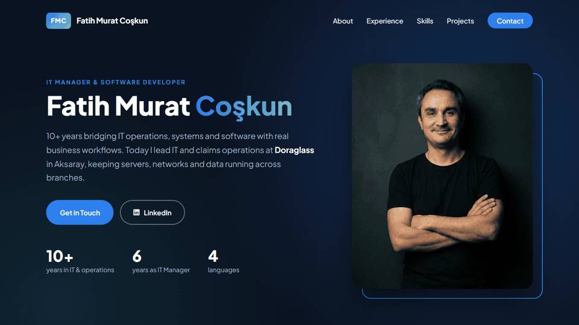

# Personal Portfolio

Personal portfolio of Fatih Murat Coşkun, IT Manager and Software Developer. A responsive, single-page site built with plain HTML, CSS and JavaScript, covering experience, skills, projects and contact details.

**Live site:** https://fmcoskun.github.io/Personal-Portfolio/

## Features

- Responsive layout with a collapsible mobile menu
- Sticky header and scroll-triggered reveal animations
- Experience timeline, skill cards and project cards
- Contact form that opens the visitor's mail client, with no backend needed

## Run locally

No build step is required. Open `index.html` in a browser.
